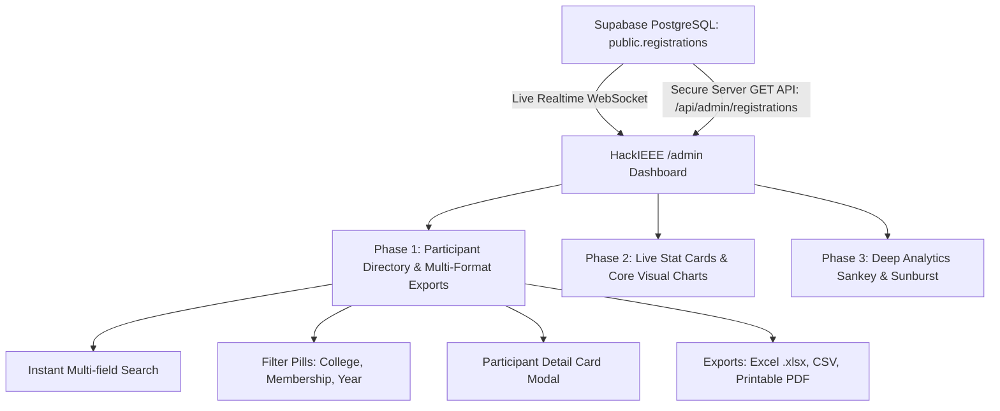

# HackIEEE 2027: Interactive Organizer Admin Dashboard & Analytics Blueprint

> **Document Type:** Master Implementation Reference & Developer Guide  
> **Target Route:** `/admin`  
> **UI Stack:** Next.js (App Router), React, Tailwind CSS, Shadcn UI, Recharts, Lucide Icons  
> **Design Theme:** HackIEEE Dune Obsidian (`#0a0705`, card `#120d09`, sand gold `#f8cf96`, spice `#e2822f`, mint `#4ade80`)

---

## 1. Architecture Overview & Phased Roadmap

The HackIEEE Organizer Dashboard is a unified, high-performance web interface built with **Shadcn UI** components. It connects directly to your live Supabase database to provide real-time attendee visibility, instant search, and export capabilities.



### Phased Delivery Order

| Phase | Priority | Deliverables | Target User Value |
| :--- | :--- | :--- | :--- |
| **Phase 1** | **Top Priority (#1)** | • Interactive Participant Directory Table<br>• Full Multi-Field Search & Filter Pills<br>• Participant Detail Card Modal (inspect any user)<br>• 1-Click Multi-Format Export Engine (Excel `.xlsx`, CSV, PDF) | Immediate access to attendee lists, individual participant verification, and exportable rosters for university & sponsor reports. |
| **Phase 2** | **Priority (#2)** | • 4 Live KPI Stat Cards (Realtime pulse)<br>• Registration Velocity Line Chart (daily/weekly trends)<br>• Donut / Circle Comparison Chart (IEEE vs Non-IEEE, Year)<br>• Top 10 Colleges Ranked Bar Leaderboard | Macro-level pulse checks, outreach monitoring, and marketing conversion analytics. |
| **Phase 3** | **Priority (#3)** | • Sankey Participant Flow Diagram (College ➔ Branch ➔ IEEE)<br>• Sunburst Radial Hierarchy Tree (Region ➔ College ➔ Branch) | Advanced multi-dimensional cohort discovery and demographic research. |

---

## 2. Pre-Written Database & Realtime Setup Commands

All database scripts are stored in the project's root `supabase/` directory (e.g. `supabase/admin-schema.sql`, `supabase/queries.sql`). Run these exact SQL commands in your **Supabase Dashboard ➔ SQL Editor ➔ New query ➔ Run**.

### 2.1 Enable Live Realtime on the `registrations` Table
*(Note: This does **not** alter columns or data in `public.registrations`; it merely publishes change events to the realtime channel).*

```sql
-- 1. Enable Supabase Realtime broadcast for registrations table
ALTER PUBLICATION supabase_realtime ADD TABLE public.registrations;
```

### 2.2 Verify Realtime Publication Status
```sql
-- Verify that registrations is active in the realtime publication
SELECT schemaname, tablename 
FROM pg_publication_tables 
WHERE pubname = 'supabase_realtime';
```

### 2.3 Create the Admin Access Control Table (`admin_users`)
*(Keeps admin verification strictly in the database; no email whitelists in `.env` files).*

```sql
-- 2. Create the admin_users table for team access control
CREATE TABLE IF NOT EXISTS public.admin_users (
  id UUID PRIMARY KEY DEFAULT gen_random_uuid(),
  email TEXT UNIQUE NOT NULL,
  full_name TEXT,
  role TEXT NOT NULL DEFAULT 'organizer', -- 'owner', 'admin', 'organizer'
  is_active BOOLEAN NOT NULL DEFAULT true,
  last_login TIMESTAMPTZ,
  created_at TIMESTAMPTZ NOT NULL DEFAULT timezone('utc'::text, now())
);

-- Enable Row Level Security (RLS)
ALTER TABLE public.admin_users ENABLE ROW LEVEL SECURITY;

-- Backend Service Role has full access using SUPABASE_SERVICE_ROLE_KEY
DROP POLICY IF EXISTS "Service role full access on admin_users" ON public.admin_users;
CREATE POLICY "Service role full access on admin_users"
  ON public.admin_users
  FOR ALL
  TO service_role
  USING (true)
  WITH CHECK (true);

-- Authenticated admins can read their own row
DROP POLICY IF EXISTS "Admins can view their own record" ON public.admin_users;
CREATE POLICY "Admins can view their own record"
  ON public.admin_users
  FOR SELECT
  TO authenticated
  USING (email = auth.jwt() ->> 'email');
```

### 2.4 Pre-Seed Initial Admins & Owners
```sql
-- 3. Add your organizing team members (replace with actual team emails)
INSERT INTO public.admin_users (email, full_name, role, is_active)
VALUES 
  ('lead@ieeenirma.org', 'Lead Organizer', 'owner', true),
  ('deep@computer.org', 'Technical Coordinator', 'admin', true)
ON CONFLICT (email) DO UPDATE 
SET role = EXCLUDED.role, is_active = true;
```

---

## 3. Phase 1 Specification: Participant Directory, Detail Modal & Exports (Priority #1)

### 3.1 Interactive Participant Directory Table

* **Component:** `app/components/admin/ParticipantTable.tsx`
* **Shadcn UI Base:** `Table`, `TableHeader`, `TableRow`, `TableCell`, `TableBody`, `Input`, `Badge`.
* **Instant Search Input:**
  - Real-time debounced search filtering across:
    - `registration_id` (e.g. `HI27-PP03-8K94`)
    - `full_name`
    - `email` & `college_email`
    - `phone`
    - `university`
    - `branch`
* **Filter Pills (Multi-Select):**
  - **College Filter:** Pill selector of top colleges + search.
  - **IEEE Membership:** `[ All | IEEE Members | Non-Members | IEEE CS Members ]`.
  - **Year of Study:** `[ All | 1st Year | 2nd Year | 3rd Year | 4th Year | Postgrad ]`.
  - **Degree:** `[ All | B.Tech | M.Tech | BCA/MCA | Other ]`.
* **Table Columns:**
  1. `Registration ID` (Monospace Dune gold font `#f8cf96`).
  2. `Participant Name` (Bold white text).
  3. `Email & Phone` (Contact subtext).
  4. `University` (Institution name with truncate).
  5. `Degree & Branch` (e.g. `B.Tech, CSE`).
  6. `Year` (Pill badge).
  7. `IEEE Status` (Green pill for `Active Member`, muted sand for `Non-Member`).
  8. `Registered At` (Clean formatted date/time).
  9. `Action` ("View Details" button).

---

### 3.2 Participant Detail Card Modal

* **Component:** `app/components/admin/ParticipantDetailModal.tsx`
* **Shadcn UI Base:** `Dialog`, `DialogContent`, `DialogHeader`, `DialogTitle`.
* **Interaction:** Clicking any table row opens this slide-out / modal dialog displaying the participant's complete dossier:
  * **Header Banner:**
    - Full Name in Dune Rise typography.
    - Large official Registration ID (`HI27-XXXX-XXXX`).
    - Verified green checkmark badge + submission timestamp.
  * **Academic Card:**
    - University / Institution Name.
    - Degree & Major Branch.
    - Year of Study & Expected Graduation Year.
    - College Email ID (if provided).
  * **Contact & Personal Information:**
    - Personal Email with copy-to-clipboard button.
    - Phone Number with WhatsApp link shortcut (`https://wa.me/...`).
    - City, State, Country.
  * **IEEE Affiliation Details:**
    - IEEE Membership: `Yes` / `No`.
    - IEEE Member Number (e.g., `#99887766`).
    - IEEE Computer Society Chapter Member: `Yes` / `No`.
  * **Online Presence & Links:**
    - GitHub profile button (direct external link).
    - LinkedIn profile button (direct external link).
    - Source ("How did you hear about HackIEEE?").
  * **Raw JSON Payload Inspector:**
    - Collapsible accordion displaying the raw `data` JSONB object for quick technical verification.

---

### 3.3 Multi-Format Export Engine

* **Component:** `app/components/admin/ExportToolbar.tsx`
* **Actions Available:**

#### 1. Excel Spreadsheet (`.xlsx`)
* Library: `xlsx` (SheetJS).
* Automatically structures a dual-tab spreadsheet:
  - **Sheet 1 ("Summary & Metrics"):** Total count, IEEE Member %, Unique Colleges count, Top 10 Colleges table.
  - **Sheet 2 ("Attendees Roster"):** Formatted table containing all columns with customized cell widths and frozen header row.

```ts
// Ready-to-use Excel Export Helper
import * as XLSX from "xlsx";

export function exportToExcel(registrations: any[], filename = "HackIEEE_Registrations.xlsx") {
  const formattedRows = registrations.map((r, i) => ({
    "S.No": i + 1,
    "Registration ID": r.registration_id,
    "Full Name": r.full_name,
    "Email": r.email,
    "College Email": r.college_email || "-",
    "Phone": r.phone,
    "University": r.university,
    "Degree": r.degree,
    "Branch": r.branch,
    "Year of Study": r.year_of_study,
    "Graduation Year": r.graduation_year || "-",
    "IEEE Member": r.is_ieee_member ? "Yes" : "No",
    "IEEE Number": r.ieee_membership_number || "-",
    "IEEE CS Member": r.is_ieee_cs_member ? "Yes" : "No",
    "GitHub": r.github_url || "-",
    "LinkedIn": r.linkedin_url || "-",
    "Registered At": new Date(r.created_at).toLocaleString("en-IN"),
  }));

  const wb = XLSX.utils.book_new();
  const ws = XLSX.utils.json_to_sheet(formattedRows);
  
  // Set clean column widths
  ws["!cols"] = [
    { wch: 6 }, { wch: 18 }, { wch: 22 }, { wch: 28 },
    { wch: 28 }, { wch: 16 }, { wch: 32 }, { wch: 14 },
    { wch: 24 }, { wch: 12 }, { wch: 14 }, { wch: 12 },
    { wch: 16 }, { wch: 14 }, { wch: 25 }, { wch: 25 }, { wch: 20 }
  ];

  XLSX.utils.book_append_sheet(wb, ws, "Participants");
  XLSX.writeFile(wb, filename);
}
```

#### 2. Clean CSV Export
* Native browser Blob generation (lightweight, zero dependencies).
* Respects active search and filter criteria so organizers can export filtered subsets (e.g. "Only Nirma University IEEE Members").

```ts
// Ready-to-use CSV Export Helper
export function exportToCsv(registrations: any[], filename = "HackIEEE_Registrations.csv") {
  const headers = [
    "Registration ID", "Full Name", "Email", "Phone", "University",
    "Degree", "Branch", "Year", "IEEE Member", "IEEE Number", "Registered At"
  ];
  
  const csvRows = [
    headers.join(","),
    ...registrations.map(r => [
      `"${r.registration_id}"`,
      `"${r.full_name.replace(/"/g, '""')}"`,
      `"${r.email}"`,
      `"${r.phone}"`,
      `"${r.university.replace(/"/g, '""')}"`,
      `"${r.degree}"`,
      `"${r.branch.replace(/"/g, '""')}"`,
      `"${r.year_of_study}"`,
      `"${r.is_ieee_member ? 'Yes' : 'No'}"`,
      `"${r.ieee_membership_number || ''}"`,
      `"${new Date(r.created_at).toISOString()}"`
    ].join(","))
  ];

  const blob = new Blob([csvRows.join("\n")], { type: "text/csv;charset=utf-8;" });
  const url = URL.createObjectURL(blob);
  const a = document.createElement("a");
  a.href = url;
  a.download = filename;
  a.click();
  URL.revokeObjectURL(url);
}
```

#### 3. Printable Executive PDF Report
* Formatted printable stylesheet (`@media print`) triggered via `window.print()`.
* Formatted in clean A4 Landscape orientation:
  - Header with HackIEEE Dune Rise branding + IEEE CS Nirma University logo.
  - KPI Stat summary table.
  - Clean formatted participant roster.

---

## 4. Phase 2 Specification: Live Stat Cards & Visual Analytics (Priority #2)

### 4.1 4 Live KPI Stat Cards (`StatCardsGrid.tsx`)

Placed directly above the data table in a responsive 4-column layout:

1. **Total Registrations Card:**
   - Big number display (`348`).
   - Live pulse indicator (green dot with CSS pulse).
   - Rate metric (`+X today`).
2. **IEEE Membership Breakdown Card:**
   - Active members tally and percentage (`184 / 348 - 52.8%`).
   - IEEE CS Chapter members sub-metric.
   - Non-members tally.
3. **Total Colleges Represented Card:**
   - Unique colleges count (`42 Institutions`).
   - Cross-state national representation metric.
4. **Top Ranked College Banner Card:**
   - #1 ranked institution name (`Nirma University`).
   - Participant count & percentage share of total hackathon volume.
   - Runner-up badge.

---

### 4.2 Core Visual Analytics Charts

#### A. Registration Velocity Line Chart (`RegistrationTrendChart.tsx`)
* Library: `recharts` (`ResponsiveContainer`, `AreaChart`, `Area`, `Line`, `XAxis`, `YAxis`, `Tooltip`).
* Shows daily registration spikes and total cumulative trajectory curve.
* Quick time filters: `[ 7 Days | 14 Days | 30 Days | All Time ]`.

#### B. Demographics Donut / Circle Chart (`DemographicsDonutChart.tsx`)
* Library: `recharts` (`PieChart`, `Pie`, `Cell`, `Tooltip`).
* Visualizes:
  - Mode 1: IEEE Affiliation (IEEE Member vs Non-Member).
  - Mode 2: Year of Study distribution (1st, 2nd, 3rd, 4th Year).
* Center badge displays hovered cohort's exact percentage.

#### C. Top 10 Colleges Leaderboard Bar Chart (`TopCollegesChart.tsx`)
* Library: `recharts` (`BarChart`, `Bar`, `XAxis`, `YAxis`, `Tooltip`).
* Ranked horizontal bars comparing leading universities.
* Hover tooltip reveals IEEE member count vs non-member count inside that college.

---

## 5. Phase 3 Specification: Deep Analytics (Priority #3)

Loaded on an on-demand sub-tab (`Tabs` component in Shadcn UI) to prevent initial load bloat:

### 5.1 Sankey Participant Flow Diagram ("Shanky's Diagram")
* **Flow Pipeline:**  
  $$\text{Top 5 Colleges} \longrightarrow \text{Branch / Specialization} \longrightarrow \text{IEEE Membership}$$
* Calculated using `d3-sankey` coordinates, rendered as native interactive SVG paths with hover illumination and tooltips.

### 5.2 Sunburst Radial Hierarchy Diagram
* Radial hierarchical tree:
  - Center: HackIEEE 2027 Total
  - Ring 1: Geographic State (Gujarat, Maharashtra, Karnataka, Other)
  - Ring 2: Universities
  - Ring 3: Technical Departments / Branches
* Interactive zoom-on-click into specific institutions.

---

## 6. Live Supabase Connection Code Snippet

Use this exact hook pattern in `app/admin/page.tsx` for real-time synchronization:

```tsx
"use client";

import { useEffect, useState, useCallback } from "react";
import { getSupabaseBrowserClient } from "@/app/lib/supabase/client";

export function useLiveRegistrations() {
  const [registrations, setRegistrations] = useState<any[]>([]);
  const [loading, setLoading] = useState(true);
  const [lastSync, setLastSync] = useState<Date>(new Date());

  const fetchLive = useCallback(async () => {
    try {
      const res = await fetch("/api/admin/registrations");
      const data = await res.json();
      if (data.success && Array.isArray(data.registrations)) {
        setRegistrations(data.registrations);
        setLastSync(new Date());
      }
    } catch (err) {
      console.error("Failed to fetch live registrations:", err);
    } finally {
      setLoading(false);
    }
  }, []);

  useEffect(() => {
    fetchLive();

    const supabase = getSupabaseBrowserClient();
    const channel = supabase
      .channel("admin-registrations-realtime")
      .on(
        "postgres_changes",
        { event: "*", schema: "public", table: "registrations" },
        (payload) => {
          console.log("[Realtime DB Change detected]:", payload.eventType);
          fetchLive(); // Instantly refresh table & stats
        }
      )
      .subscribe();

    return () => {
      supabase.removeChannel(channel);
    };
  }, [fetchLive]);

  return { registrations, loading, lastSync, refetch: fetchLive };
}
```

---

## 7. Backend Endpoint: `GET /api/admin/registrations`

Create `app/api/admin/registrations/route.ts`:

```ts
import { NextRequest, NextResponse } from "next/server";
import { getSupabaseAdminClient } from "@/app/lib/supabase/server";

export async function GET(req: NextRequest) {
  try {
    const supabase = getSupabaseAdminClient();
    if (!supabase) {
      return NextResponse.json({ success: false, error: "Database unconfigured" }, { status: 500 });
    }

    // Read directly from existing public.registrations table without modifying it
    const { data, error } = await supabase
      .from("registrations")
      .select("*")
      .order("created_at", { ascending: false });

    if (error) {
      return NextResponse.json({ success: false, error: error.message }, { status: 400 });
    }

    return NextResponse.json({
      success: true,
      count: data.length,
      registrations: data,
    });
  } catch (err: unknown) {
    const msg = err instanceof Error ? err.message : "Internal server error";
    return NextResponse.json({ success: false, error: msg }, { status: 500 });
  }
}
```

---

## 8. Summary Checklist for Developer

- [ ] **Run SQL Commands:** Run Section 2 SQL scripts in Supabase SQL Editor (Realtime publication + `admin_users` table).
- [ ] **Implement Phase 1:**
  - [ ] Build `ParticipantTable.tsx` with search and filter pills.
  - [ ] Build `ParticipantDetailModal.tsx` for full card inspections.
  - [ ] Add `ExportToolbar.tsx` with Excel (`.xlsx`), CSV, and PDF handlers.
- [ ] **Implement Phase 2:**
  - [ ] Add `StatCardsGrid.tsx` for 4 KPI stat cards.
  - [ ] Add `RegistrationTrendChart.tsx` (Line) and `DemographicsDonutChart.tsx` (Donut).
  - [ ] Add `TopCollegesChart.tsx` (Ranked leaderboard).
- [ ] **Implement Phase 3:**
  - [ ] Add `SankeyFlowChart.tsx` and `SunburstChart.tsx` under a secondary tab.
- [ ] **Verify Realtime Sync:** Test registration submission in an incognito window; confirm `/admin` updates in real time without browser refresh.
- [ ] **Build Validation:** Run `npm run build` and ensure 0 errors.
